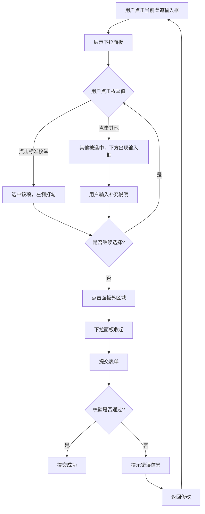
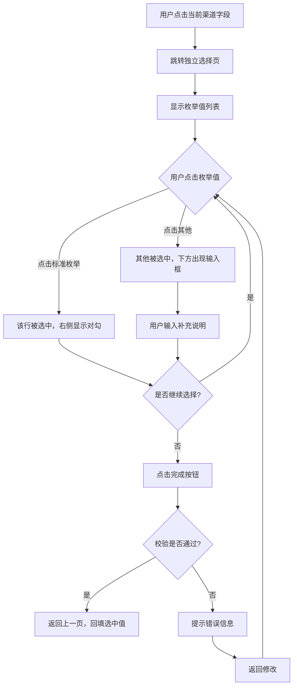
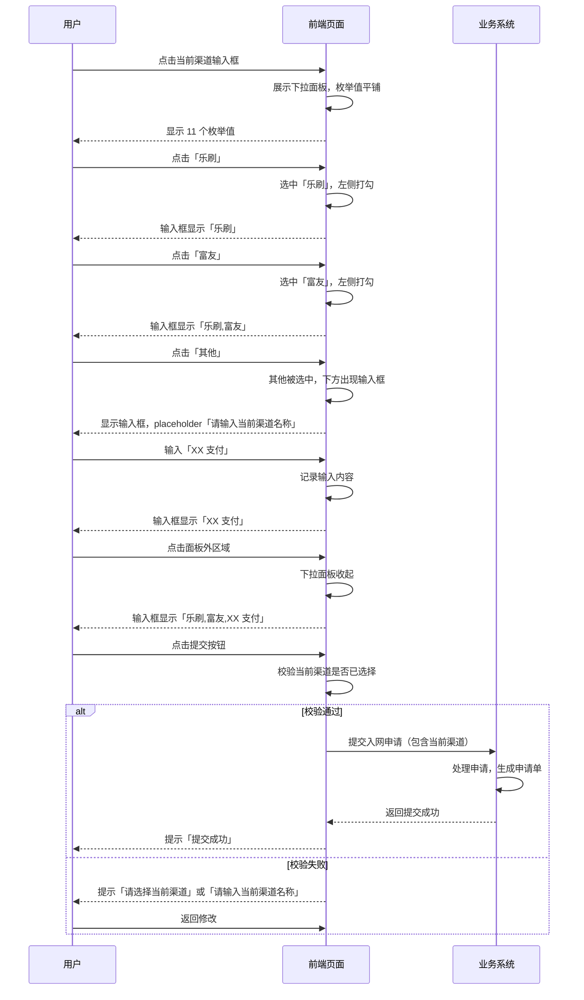
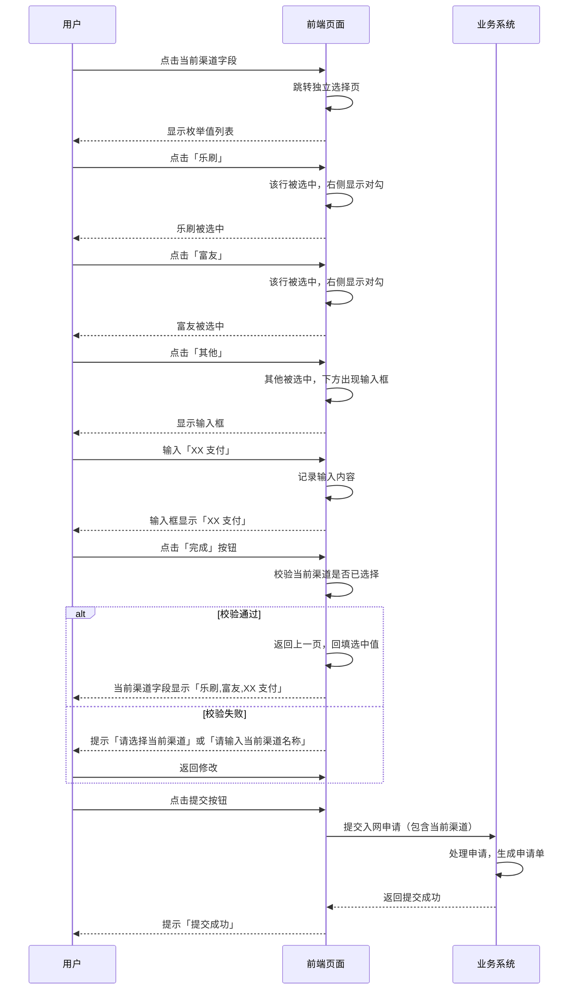

# 机构入网-当前渠道字段改造-PRD

## 一、背景

当前机构入网申请流程中，"当前渠道"字段为单行文本输入，存在以下问题：
- 用户填写不规范，同一渠道有多种写法（如"拉卡拉"写成"拉卡啦"、"随行付"写成"随行付支付"）
- 数据口径不统一，影响后续统计分析和分润计算
- 无法准确识别用户所属渠道，增加人工审核成本

## 二、目标

- 将"当前渠道"字段从文本输入改为枚举选择，支持多选
- PC 端：改为下拉选择框，支持多选
- 手机端：改为独立选择页，支持多选
- 统一数据标准，提升数据质量和填写效率
- 支持"其他"选项，允许用户手动输入补充说明

## 三、需求范围

| 功能模块 | 涉及端 | 改造点 |
|---|---|---|
| 当前渠道选择 | PC 端 | 文本输入 → 下拉多选框 |
| 当前渠道选择 | 手机端 | 文本输入 → 独立选择页（多选） |

## 四、枚举值定义

当前渠道枚举值共 11 个：

| 序号 | 枚举值 | 说明 |
|---|---|---|
| 1 | 乐刷 | 支付渠道 |
| 2 | 富友 | 支付渠道 |
| 3 | 好哒 | 支付渠道 |
| 4 | 随行付 | 支付渠道 |
| 5 | 拉卡拉 | 支付渠道 |
| 6 | 易宝 | 支付渠道 |
| 7 | 汇付 | 支付渠道 |
| 8 | 国通 | 支付渠道 |
| 9 | 汇来米 | 支付渠道 |
| 10 | 收钱吧 | 支付渠道 |
| 11 | 其他 | 选择后展示可编辑输入框，最多 50 字 |

## 五、方案说明

### 方案一：PC 端 - 下拉选择框

**入口**：机构入网申请页面 → 当前渠道字段（在原页面直接改造）

**改造说明**：
- 原字段：单行文本输入框，placeholder "请输入当前渠道"
- 改造后：下拉选择框，支持多选，placeholder "请选择当前渠道"
- 选择完成后，填写当前渠道的文本输入框内显示已选择的渠道，逗号分隔
- 选择「其他」时，展示可编辑输入框

**控件样式**：
- 输入框高度：与表单其他输入框一致（62px）
- 边框：1px solid #d9d9d9
- 圆角：4px
- placeholder：「请选择当前渠道」
- 下拉面板：白底，带轻微阴影，最大高度 300px，超出滚动
- 选项高度：34px
- 选项 hover：背景 #f5f5f5
- 已选中项：蓝色高亮 #1677ff，左侧显示勾选框

**交互逻辑**：
1. 用户点击「当前渠道」输入框，展示下拉面板，枚举值平铺展示，支持多选
2. 用户点击某个枚举值（如「乐刷」），该选项被选中，左侧勾选框打勾，输入框显示「乐刷」
3. 用户可继续点击其他枚举值（如「富友」），实现多选，输入框显示「乐刷,富友」
4. 用户点击「其他」，「其他」被选中，下方出现可编辑输入框，placeholder 为「请输入当前渠道名称」
5. 用户在输入框内手动输入渠道名称（如「XX 支付」），最多 50 字
6. 用户点击下拉面板外的任意区域，下拉面板收起
7. 用户可再次点击输入框，重新打开下拉面板，修改已选值

**校验规则**：
- 必填校验：提交时，当前渠道不能为空，未选择则提示「请选择当前渠道」
- 其他输入校验：选择「其他」但未填写输入框，提示「请输入当前渠道名称」
- 字数限制：其他输入框最多 50 字，超过截断

### 方案二：手机端 - 独立选择页

**入口**：机构入网申请页面 → 点击「当前渠道」字段 → 跳转独立选择页

**页面结构**：
- 顶部导航栏：标题「当前渠道」，左侧返回按钮，右侧「完成」按钮
- 内容区：枚举值列表，垂直排列，整行可点击，支持多选

**交互逻辑**：
1. 用户点击「当前渠道」字段，跳转独立选择页
2. 页面顶部显示标题「当前渠道」，右上角「完成」按钮
3. 枚举值列表垂直排列，整行可点击
4. 用户点击某个枚举值（如「乐刷」），该行被选中，右侧显示对勾，支持多选
5. 用户点击「其他」，下方出现可编辑输入框，最多 50 字
6. 用户点击「完成」，校验是否选择当前渠道，未选择则提示「请选择当前渠道」
7. 校验通过后，返回上一页，回填选中值，显示为「乐刷,富友」格式

**校验规则**：
- 必填校验：点击「完成」时，未选择任何渠道，提示「请选择当前渠道」
- 其他输入校验：选择「其他」但未填写，提示「请输入当前渠道名称」
- 字数限制：其他输入框最多 50 字

## 六、流程说明

### 6.1 PC 端流程



**说明**：
- 下拉面板支持多选，用户可连续选择多个枚举值
- 选择「其他」后，下方出现输入框，用户可输入补充说明
- 输入框最多 50 字，超过截断
- 提交时校验：未选择提示「请选择当前渠道」，选择「其他」未填写提示「请输入当前渠道名称」
- 连线交叉数：0
- 连线穿框数：0
- 文字压盖数：0
- 节点重叠数：0

### 6.2 手机端流程



**说明**：
- 独立选择页支持多选，用户可选择多个枚举值
- 选择「其他」后，下方出现输入框，用户可输入补充说明
- 输入框最多 50 字
- 点击「完成」校验：未选择提示「请选择当前渠道」，选择「其他」未填写提示「请输入当前渠道名称」
- 校验通过后，返回上一页，回填选中值，显示为「乐刷,富友」格式
- 连线交叉数：0
- 连线穿框数：0
- 文字压盖数：0
- 节点重叠数：0

## 七、时序图

### 7.1 PC 端时序图



### 7.2 手机端时序图



## 八、页面说明

### 8.1 PC 端页面

| 字段 | 类型 | 必填 | 说明 |
|---|---|---|---|
| 当前渠道 | 下拉多选框 | 是 | 枚举值，支持多选 |
| 补充说明 | 文本输入框 | 条件必填 | 选择「其他」时显示，最多 50 字 |

**交互细节**：
- 输入框 placeholder：「请选择当前渠道」
- 下拉面板最大高度：300px
- 选项高度：34px
- 选项 hover 背景：#f5f5f5
- 已选中项背景：#1677ff，文字白色
- 输入框显示已选值，逗号分隔

### 8.2 手机端页面

| 字段 | 类型 | 必填 | 说明 |
|---|---|---|---|
| 当前渠道 | 列表选择 | 是 | 枚举值，支持多选 |
| 补充说明 | 文本输入框 | 条件必填 | 选择「其他」时显示，最多 50 字 |

**交互细节**：
- 顶部导航栏：标题「当前渠道」，左侧返回按钮，右侧「完成」按钮
- 枚举值列表：垂直排列，整行可点击
- 选中状态：右侧显示对勾
- 选择「其他」后，下方出现输入框
- 点击「完成」校验后返回上一页

## 九、字段规则

| 字段 | 规则 | 说明 |
|---|---|---|
| 当前渠道 | 必填，枚举值，支持多选 | 未选择提示「请选择当前渠道」 |
| 补充说明 | 条件必填，最多 50 字 | 选择「其他」时必填，未填写提示「请输入当前渠道名称」 |

## 十、接口定义

### 10.1 提交入网申请

```
POST /api/merchant/onboarding
```

**请求参数**

| 字段 | 类型 | 必填 | 说明 |
|---|---|---|---|
| merchantName | string | 是 | 商户名称 |
| contactPhone | string | 是 | 联系电话 |
| currentChannel | array | 是 | 当前渠道（数组格式） |
| currentChannelOther | string | 条件必填 | 补充说明（选择「其他」时必填） |

**请求示例**

```json
{
  "merchantName": "某某商户",
  "contactPhone": "13800138000",
  "currentChannel": ["乐刷", "富友", "其他"],
  "currentChannelOther": "XX 支付"
}
```

**返回示例**

```json
{
  "code": 0,
  "msg": "success",
  "data": {
    "applyId": "202611170001",
    "status": "pending"
  }
}
```

**错误码**

| 错误码 | 说明 | 提示 |
|---|---|---|
| 1001 | 参数校验失败 | 请检查必填字段 |
| 1002 | 当前渠道未选择 | 请选择当前渠道 |
| 1003 | 补充说明未填写 | 请输入当前渠道名称 |
| 2001 | 系统异常 | 请稍后重试 |

## 十一、异常处理

| 异常场景 | 处理策略 |
|---|---|
| 用户未选择当前渠道直接提交 | 前端校验拦截，提示「请选择当前渠道」，不发起请求 |
| 用户选择「其他」但未填写补充说明 | 前端校验拦截，提示「请输入当前渠道名称」，不发起请求 |
| 用户在补充说明输入框输入超过 50 字 | 前端截断，最多保留 50 字 |
| 用户点击面板外区域，下拉面板未收起 | 监听点击事件，自动收起面板 |
| 用户点击「完成」但未选择任何渠道 | 前端校验拦截，提示「请选择当前渠道」，不返回上一页 |
| 接口调用失败 | 前端提示「网络异常，请重试」，用户可重新提交 |

## 十二、安全策略

1. **前端校验**：必填字段前端校验，未填写不允许提交
2. **后端校验**：后端接收请求后，再次校验必填字段
3. **字数限制**：补充说明输入框最多 50 字，后端限制字段长度
4. **枚举值校验**：后端校验当前渠道值是否在枚举范围内
5. **防重复提交**：提交按钮点击后置灰，防止重复点击
6. **敏感信息脱敏**：手机号等敏感信息在日志中脱敏处理

## 十三、验收标准

### PC 端
- [ ] 输入框 placeholder 显示「请选择当前渠道」
- [ ] 点击输入框展开下拉面板，包含 11 个枚举值
- [ ] 可选择多个枚举值，输入框显示已选值，逗号分隔
- [ ] 选择「其他」后，出现可编辑输入框
- [ ] 不选择直接提交，提示「请选择当前渠道」
- [ ] 选「其他」不填名称提交，提示「请输入当前渠道名称」

### 手机端
- [ ] 点击「当前渠道」跳转独立选择页
- [ ] 页面展示 11 个枚举值，整行可点击
- [ ] 可选择多个枚举值，选中后右侧显示对勾
- [ ] 选择「其他」后，下方出现输入框
- [ ] 点击「完成」校验必填
- [ ] 返回上一页后回填选中值，逗号分隔

## 十四、原型访问

### PC 端（基于原入网页面改造）
- 改造图：`机构入网当前渠道PC-改造后.png`（在原页面基础上展示改造效果）
- 可交互原型：https://gaohailinga.github.io/current-channel-prototype/pc-channel-select.html

### 手机端（独立选择页）
- 改造图：`当前渠道选择页-改造后.png`
- 可交互原型：https://gaohailinga.github.io/current-channel-prototype/index.html

## 十五、数据可行性分析

### 15.1 数据来源
- 枚举值基于现有支付渠道，数据来源可靠
- 用户选择后，数据直接存储到数据库

### 15.2 数据存储
- 当前渠道字段从 string 改为 array 类型
- 补充说明字段从 string 类型，最多 50 字
- 历史数据保持不变，新增数据使用新字段

### 15.3 数据迁移
- 历史数据中已填写的「当前渠道」值保持不变，不做迁移
- 新增数据统一使用枚举值，提升数据一致性

### 15.4 数据查询
- 查询时，当前渠道字段为数组，支持多值查询
- 补充说明字段为字符串，支持模糊查询
